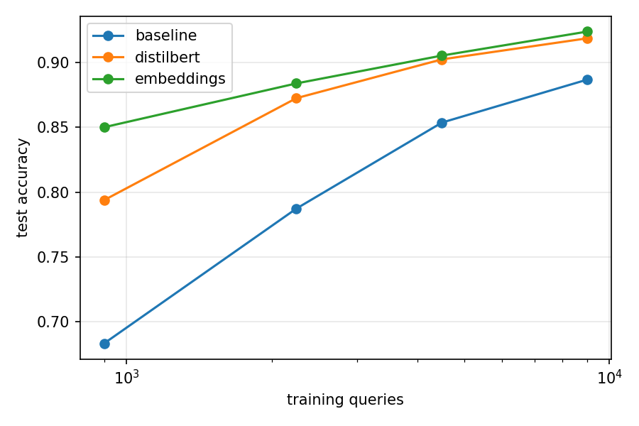
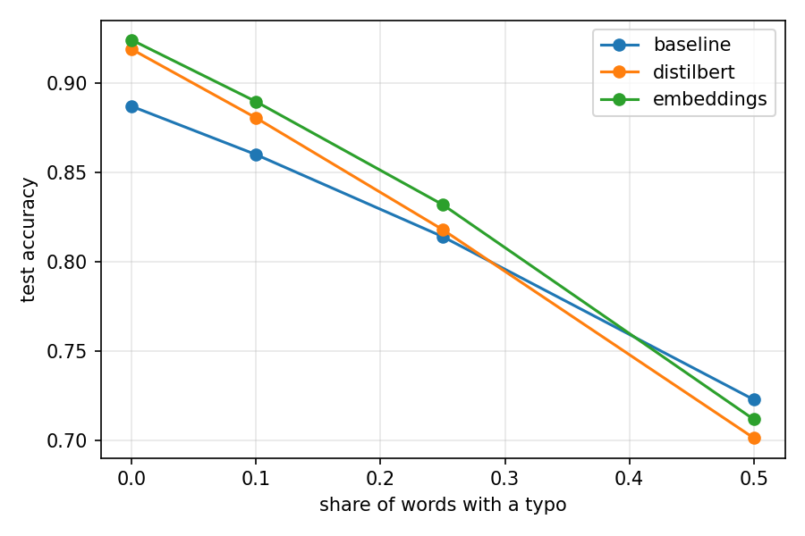

# Banking Customer-Query Intent Classification

How much better is a transformer than a classical TF-IDF baseline at recognising what a banking customer is asking, and where does each approach fail?

This is a small, rigorous NLP project: public data, a documented evaluation protocol, hypotheses written **before** any experiment was run, and an honest error analysis.

## Status

| Step | What | Status |
|------|------|--------|
| 1 | Data loading, data-quality and leakage checks | Done |
| 2 | TF-IDF + linear SVM baseline | Done |
| 3 | Sentence embeddings + linear classifier | Done |
| 4 | Fine-tuned DistilBERT (PyTorch, Hugging Face) | Done |
| 5 | Error analysis, learning curve, robustness to typos | Done |
| 6 | Final results and findings | Done |

The results section below is filled in only as each experiment is actually run.

## Key findings

1. **Pretrained representations beat TF-IDF by a clear margin.** Test accuracy was 0.894 for the TF-IDF + linear SVM baseline, 0.926 for frozen sentence embeddings + logistic regression, and 0.919 for fine-tuned DistilBERT. Both neural models beat the baseline (95% intervals +2.2 to +4.2 and +1.3 to +3.6 points), but they were statistically indistinguishable from each other.
2. **The advantage is largest when labelled data is scarce.** With 899 training queries, the embeddings model beat the baseline by 16.7 accuracy points; with the full 8,999 the gap shrank to 3.7. DistilBERT was the most data-hungry of the three.
3. **Typos did not hurt TF-IDF more, contrary to my hypothesis.** The baseline lost the least accuracy at every noise level, and the neural models' lead disappeared at heavy noise. At a realistic 10% typo rate they were still 2 to 3 points ahead.
4. **Part of the remaining error is label noise, not model weakness.** In a manual review of 31 misclassified queries, I judged 18 as probable label noise and 6 as genuine model errors. For example, every sampled `declined_transfer` query described a declined card payment. The clearest real weakness was missing cues such as "single use" for disposable virtual cards.
5. **Most of my hypotheses were wrong, and the write-up says so.** Of six hypotheses written before running anything, one was supported, one partly confirmed, and four refuted or unsupported. For example, the weakest intents were transfers, top-ups and identity verification, not card intents.

**Practical takeaway:** on a dataset of this size, frozen embeddings with a logistic regression matched fine-tuning at a fraction of the cost and needed no GPU training.

**Main limitations:** a single seed, no intervals for the learning-curve and typo results, one dataset of short single-intent queries, and an error analysis based on a non-random sample judged by one annotator.

Full results, hypotheses and methods are below.

## Dataset

[Banking77](https://huggingface.co/datasets/PolyAI/banking77): customer-service queries from the banking domain, each labelled with one of 77 intents (for example `lost_or_stolen_card` or `card_arrival`). It was introduced in Casanueva et al. (2020), *Efficient Intent Detection with Dual Sentence Encoders*.

Observed with `explore.py`:

| Property | Value |
|----------|-------|
| Train / test queries | 10,003 / 3,080 |
| Intents | 77 |
| Examples per class (train) | min 35, median 127, max 187 (about 5x imbalance) |
| Words per query | mean 11.9, median 10, max 79 |
| Duplicate queries inside train | 4 |
| Queries present in both train and test | 6 |
| Identical queries with conflicting labels | 0 |

### Data handling decisions

- **Duplicates in train are dropped.** Only 4, but there is no reason to keep them.
- **Test queries that also appear in train are removed from the test set,** so the test set is genuinely unseen. This affects 6 distinct queries (about 0.2% of the test set). Scores are therefore not exactly comparable with published Banking77 numbers.
- **Macro-F1 is the primary metric,** because the training classes are imbalanced and per-class behaviour matters. The test set is balanced (40 queries per intent, 3,074 after cleaning), so macro-F1 and accuracy are nearly identical on it; both are reported.
- Near-duplicate queries (not just exact matches) were **not** checked; this is a known limitation.

## Evaluation protocol

- Hyperparameters are chosen by **5-fold stratified cross-validation on the training set only**.
- The test set is used **once per final model**, never for tuning.
- Fixed random seed (42) throughout.
- Every experiment saves its metrics, per-class scores and predictions to `results/`, so the error analysis uses the actual predictions rather than re-running models.

## Hypotheses (written before running any experiment)

These were written down after the data checks and before running `baseline.py` or any model. They will be confirmed or refuted in the results; they are not edited afterwards.

1. **Confusion concentrates in card-related intents.** The lowest per-class F1 scores will be among intents about cards (lost or stolen card, card swallowed, card not working, contactless or virtual card not working, card acceptance), because their wording overlaps heavily.
2. **Small classes do worse.** Intents with fewer than about 60 training examples (such as `contactless_not_working`, `virtual_card_not_working` and `card_acceptance`) will have lower recall than the median class.
3. **Baseline accuracy.** The TF-IDF + linear SVM baseline will reach a test accuracy between 0.85 and 0.92, with macro-F1 slightly below accuracy.
4. **Transformer gain.** The fine-tuned DistilBERT will improve test macro-F1 over the baseline by roughly 3 to 7 points. The gain will come mostly from queries that share few words with training examples, and the confusable card intents will remain the hardest for both models.
5. **Data efficiency.** With only 10% of the training data, the sentence-embedding model will beat the TF-IDF baseline by a wider margin than it does with the full data.
6. **Robustness.** Adding random typos to the test queries will hurt the TF-IDF baseline more than the transformer, because word-level features break on misspellings while subword tokenisation degrades more gracefully.

## Methods

### Baseline (Step 2)

- Features: TF-IDF over word unigrams and bigrams with sublinear term frequency.
- Classifier: linear SVM (`LinearSVC`). Logistic regression was tried first but was too slow for a cross-validation grid; a linear SVM is the standard fast baseline for text and trains in about a second.
- Regularisation `C` is chosen from {0.1, 0.3, 1, 3} by macro-F1 under cross-validation on the training set.

### Done

- **Sentence embeddings + linear classifier:** a pretrained sentence encoder turns each query into a vector, with a simple classifier on top.
- **Fine-tuned DistilBERT:** PyTorch and Hugging Face Transformers, trained on a free Colab GPU, with a short maximum sequence length because queries are short.
- **Error analysis:** per-class scores, the most frequently confused intent pairs, and a manual look at misclassified queries.
- **Learning curve:** performance at 10%, 25%, 50% and 100% of the training data.
- **Robustness:** performance on test queries with random character-level typos.

## Results

All results use a single seed (42) and the cleaned data: 9,999 training queries and 3,074 test queries (6 test queries that also appear in train were removed). The test set was used once per final model.

### Main comparison

| Model | Test accuracy | Test macro-F1 | Notes |
|-------|---------------|---------------|-------|
| TF-IDF + linear SVM | 0.8936 | 0.8937 | Word 1-2 grams, C=3 chosen by 5-fold CV on train (CV macro-F1 0.879) |
| Sentence embeddings + logistic regression | 0.9255 | 0.9252 | Frozen all-MiniLM-L6-v2 encoder, C=100 chosen on the validation split (val macro-F1 0.934), refit on train+val. +3.2 points accuracy over the baseline (95% interval +2.2 to +4.2) |
| Fine-tuned DistilBERT | 0.9187 | 0.9185 | distilbert-base-uncased, 4 epochs, lr 5e-5, batch 32, max length 64, best epoch 4 on validation (val macro-F1 0.913). +2.5 points over the baseline (+1.3 to +3.6); not distinguishable from the embeddings model (-0.7 points, interval -1.6 to +0.3) |

The baseline used cross-validation on the full training set, while the two neural models share a stratified 90/10 train/validation split. Intervals are paired bootstrap intervals on test accuracy.

### Hypothesis outcomes

The hypotheses above were written before running any experiment and are not edited.

- **H1 (confusion concentrates in card intents): refuted.** Only 2 of the 10 lowest-F1 baseline intents mention "card" (base rate: 27 of 77 intents, so about 3.5 expected). The weakest intents concern transfers, top-ups and identity verification, which have near-synonymous neighbours (pending vs failed vs not received; `verify_my_identity` vs `why_verify_identity` vs `unable_to_verify_identity`).
- **H2 (small classes do worse): not supported.** Classes with fewer than 60 training examples (n=3) had mean recall 0.856 against 0.895 for the rest, but the Spearman correlation between training size and recall is -0.05, and several of the weakest intents have the largest training sets. With 40 test queries per intent, per-class differences are noisy.
- **H3 (baseline accuracy): partly confirmed.** Test accuracy of 0.8936 is inside the predicted 0.85 to 0.92 range. The claim that macro-F1 would be slightly below accuracy was wrong: the two are essentially equal (0.8937 vs 0.8936) because the test set is balanced (40 queries per intent); the imbalance exists only in the training data.
- **H4 (transformer gain): not supported as stated.** DistilBERT improved test macro-F1 over the baseline by 2.5 points (0.8937 to 0.9185), below the predicted 3 to 7, and was statistically indistinguishable from the frozen sentence-embedding model. The predictions that gains would come from queries sharing few words with training examples, and that card intents would stay hardest for both models, were not tested directly.
- **H5 (data efficiency): supported.** See the learning curve below.
- **H6 (typo robustness): refuted.** See the typo results below.

### Per-intent changes

Expectations about per-intent changes were recorded after the overall scores were known and before the per-class comparison.

| Expectation | Result | Verdict |
|-------------|--------|---------|
| The largest F1 gains fall on the baseline's weakest intents | 8 of the 10 largest gains, for both models, were among the baseline's 20 weakest intents; 5 of the top 10 are shared by the two models. Spearman correlation between baseline F1 and gain: -0.58 (embeddings) and -0.50 (DistilBERT), so part of the effect is regression to the mean | Supported, with that caveat |
| The identity-verification trio stays hard for every model | Errors within the trio: baseline 20, embeddings 6, DistilBERT 18 | Mixed: refuted for embeddings, supported for DistilBERT |
| Over-prediction of `card_not_working` shrinks but does not vanish | Precision 0.694 (baseline), 0.841 (embeddings), 0.848 (DistilBERT) | Supported |

Each intent has only 40 test queries, so single-intent differences of a few queries are noise.

### Learning curve

Models were trained on a stratified subsample of the 90% training split. `C` was fixed from the earlier experiments, and DistilBERT used a fixed budget of about 1,100 optimiser steps at every size (38, 16, 8 and 4 epochs).

| Training queries | Baseline | DistilBERT | Embeddings | Embeddings minus baseline |
|------------------|----------|------------|------------|---------------------------|
| 899 (10%) | 0.6831 | 0.7938 | 0.8500 | +16.7 points |
| 2,249 (25%) | 0.7872 | 0.8725 | 0.8839 | +9.7 |
| 4,499 (50%) | 0.8536 | 0.9024 | 0.9053 | +5.2 |
| 8,999 (100%) | 0.8868 | 0.9187 | 0.9239 | +3.7 |



With 899 training queries the embeddings model beat the baseline by 16.7 accuracy points, against 3.7 at the full training split, and the gap shrank monotonically. DistilBERT was the most data-hungry: it trailed the embeddings model by 5.6 points at 10% and 0.5 at 100%. All three models were still improving at 100%. The 100% row differs slightly from the main comparison because it trains on 90% of the training data.

### Typo robustness

The 100% models were evaluated on the same test queries with typos added: each purely alphabetic word of 4 or more letters receives one character edit (swap, delete or duplicate a letter, never the first or last letter) with the given probability.

| Typo rate | Baseline | DistilBERT | Embeddings |
|-----------|----------|------------|------------|
| 0 | 0.8868 | 0.9187 | 0.9239 |
| 0.10 | 0.8598 | 0.8803 | 0.8894 |
| 0.25 | 0.8139 | 0.8178 | 0.8318 |
| 0.50 | 0.7228 | 0.7014 | 0.7118 |

Accuracy lost relative to clean queries, in points:

| Typo rate | Baseline | DistilBERT | Embeddings |
|-----------|----------|------------|------------|
| 0.10 | 2.7 | 3.8 | 3.5 |
| 0.25 | 7.3 | 10.1 | 9.2 |
| 0.50 | 16.4 | 21.7 | 21.2 |



The baseline lost the least accuracy at every noise level, the opposite of H6. The neural models' absolute lead shrank as noise increased (DistilBERT +3.2 points over the baseline on clean queries, +2.0 at rate 0.10, +0.4 at 0.25) and reversed at 0.50. Part of this is a ceiling effect, since models that start higher have more to lose. A possible explanation, not tested, is that a misspelling splits a word into unfamiliar word-pieces and distorts the whole sentence representation, whereas TF-IDF only loses the corrupted words. Predictions were not saved for this experiment, so no confidence intervals are available.

### Error analysis

I manually categorised 31 misclassified test queries from the fine-tuned DistilBERT, sampled as up to 5 per confusion pair from the 8 most frequent pairs (about 250 errors in total). For the noisy pairs I checked the training data to see which label the dataset's own queries follow.

| Category | Count | Meaning |
|----------|-------|---------|
| Label noise | 18 | The predicted label fits the query better than the true label |
| Model error | 6 | The true label is clearly right and the prediction clearly wrong |
| Ambiguous | 6 | Either label is defensible |
| Too vague | 1 | Too short to tell which intent is meant |

| True label → predicted | Sampled | Pattern |
|------------------------|---------|---------|
| `why_verify_identity` → `verify_my_identity` | 5 | Mostly ambiguous: the labels overlap |
| `card_arrival` → `card_delivery_estimate` | 4 | Timing questions labelled as tracking, plus two ambiguous |
| `get_disposable_virtual_card` → `getting_virtual_card` | 4 | Mostly genuine model errors: the model ignored cues such as "single use" |
| `declined_transfer` → `declined_card_payment` | 4 | All label noise: every query describes a declined card payment |
| `balance_not_updated_after_bank_transfer` → `transfer_timing` | 4 | All label noise: every query asks how long a transfer takes |
| `fiat_currency_support` → `exchange_via_app` | 4 | All label noise: training queries for the true label ask which currencies are supported, while these ask about exchanging |
| `card_swallowed` → `declined_cash_withdrawal` | 3 | Mixed |
| `pending_transfer` → `balance_not_updated_after_bank_transfer` | 3 | Mostly label noise or model error |

Much of the apparent error in these pairs reflects the label scheme rather than the model. The clearest genuine weakness is the disposable-virtual-card pair. Accuracy on correctly labelled data is plausibly higher than the measured 0.9187, but this was not quantified. The sample is not random across all errors, so the proportions should not be extrapolated, and the categories are one annotator's judgement that has not been independently verified. The annotated sample is in [results/distilbert_error_sample.csv](results/distilbert_error_sample.csv).

## Project structure

```
.
├── data/
│   └── raw/               # Banking77 CSVs (gitignored)
├── results/               # metrics, per-class scores, predictions, curves, plots, error sample
├── data.py                # loads Banking77 (local CSVs, else Hugging Face Hub)
├── explore.py             # dataset statistics and leakage / quality checks
├── baseline.py            # TF-IDF + linear SVM, cross-validated, evaluated once on test
├── embeddings.py          # frozen sentence embeddings + logistic regression
├── finetune.py            # DistilBERT fine-tuning (PyTorch / Hugging Face), reusable fit()
├── report.py              # shared train/validation split and results saving
├── robustness.py          # learning curve (H5) and typo robustness (H6)
├── perturb.py             # deterministic typo generator
├── analyse.py             # per-intent scores and most frequent confusions for one model
├── compare.py             # paired model comparison and per-intent gains
├── errors.py              # samples misclassified queries for manual error analysis
├── requirements.txt
└── README.md
```

## Setup and usage

Requires Python 3.10+.

```bash
python -m venv .venv
source .venv/bin/activate          # macOS / Linux
source .venv/Scripts/activate      # Windows, Git Bash
pip install -r requirements.txt
```

### Getting the data

`data.py` first looks for local CSVs in `data/raw/` and otherwise downloads the dataset from the Hugging Face Hub. If you are offline or the Hub is unreachable, download the original files:

```bash
mkdir -p data/raw
curl -L -o data/raw/train.csv https://raw.githubusercontent.com/PolyAI-LDN/task-specific-datasets/master/banking_data/train.csv
curl -L -o data/raw/test.csv  https://raw.githubusercontent.com/PolyAI-LDN/task-specific-datasets/master/banking_data/test.csv
```

### Running

```bash
python explore.py      # dataset statistics and data-quality checks
python baseline.py     # baseline: cross-validation, then one test evaluation
```

Outputs are written to `results/`: `baseline_metrics.json`, `baseline_per_class.csv` and `baseline_predictions.csv`.

## Limitations so far

- Only exact duplicates were checked; near-duplicates between train and test may remain.
- Banking77 queries are short, single-intent and relatively clean, so results may not carry over to long or noisy text such as emails or complaint narratives.
- Removing 6 overlapping queries from the test set makes scores slightly incomparable with published results.
- Results will come from a single fixed seed unless stated otherwise, so small differences between models should not be over-interpreted.
- Single seed, no intervals for the learning-curve and typo results.
    
    
